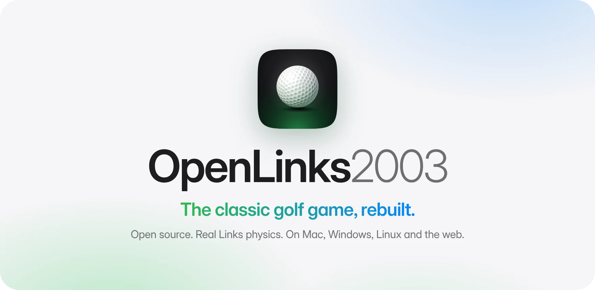
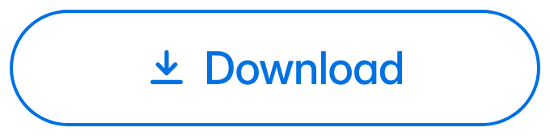
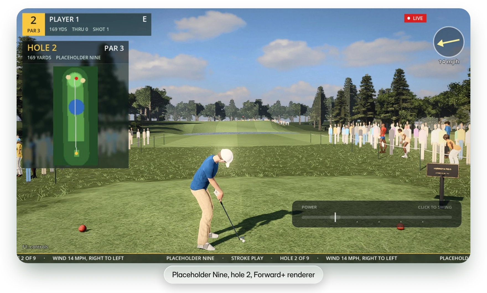
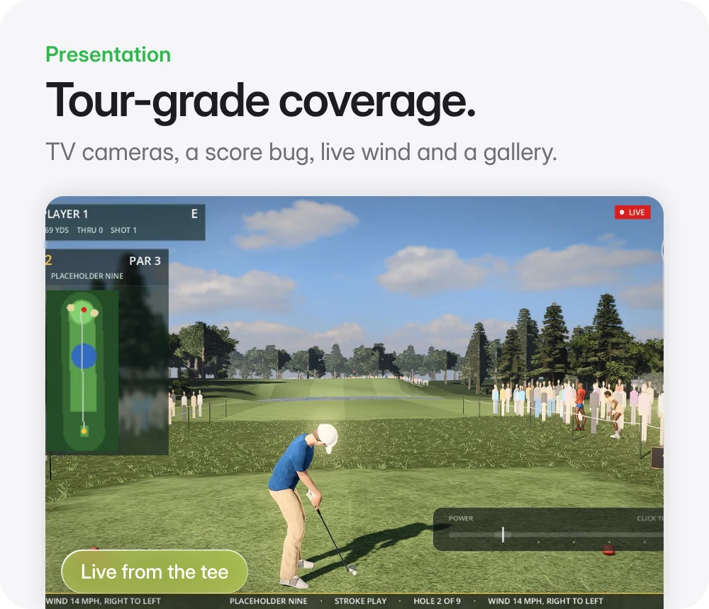
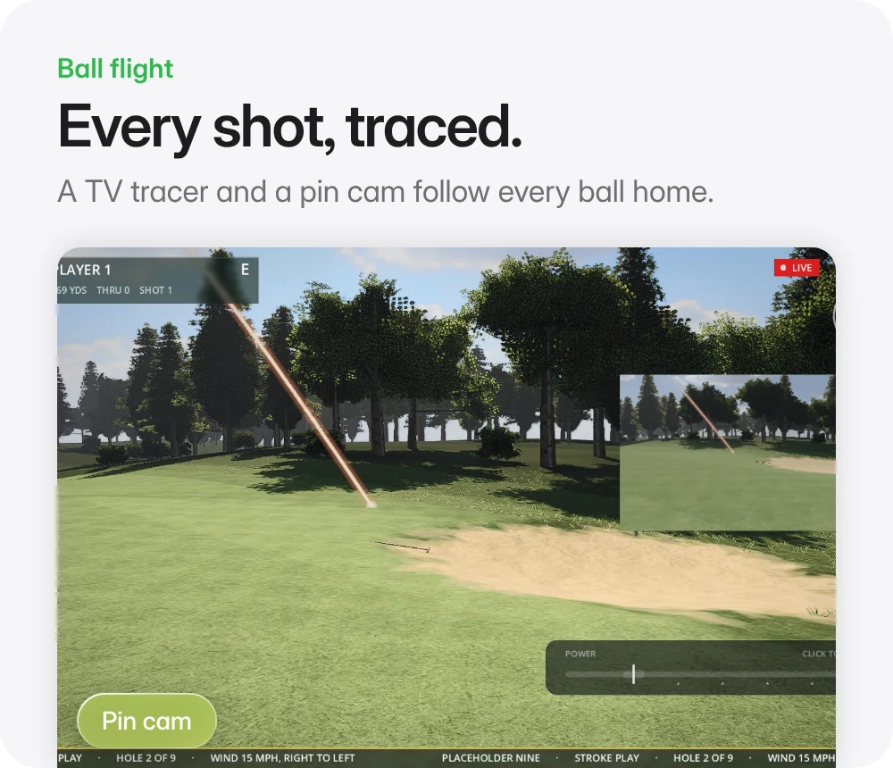
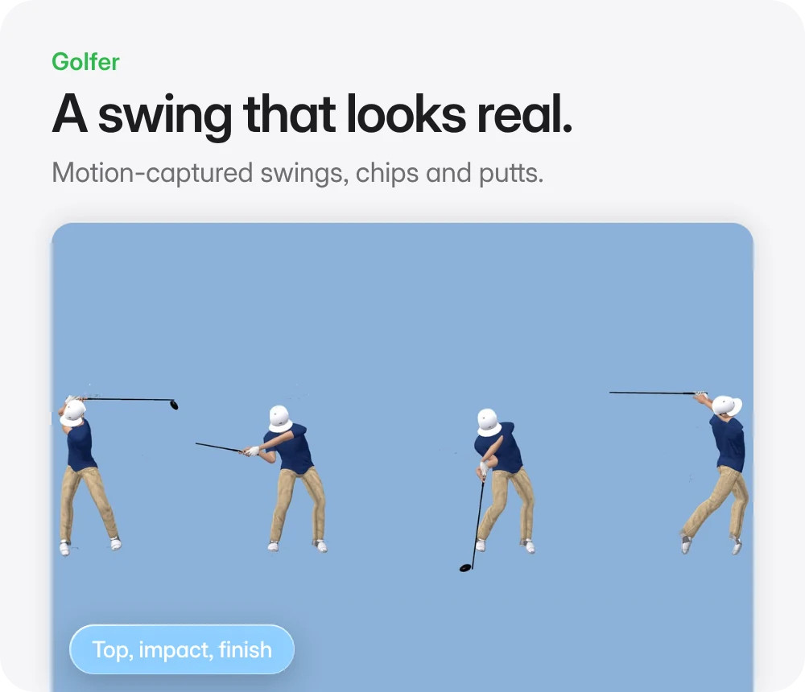
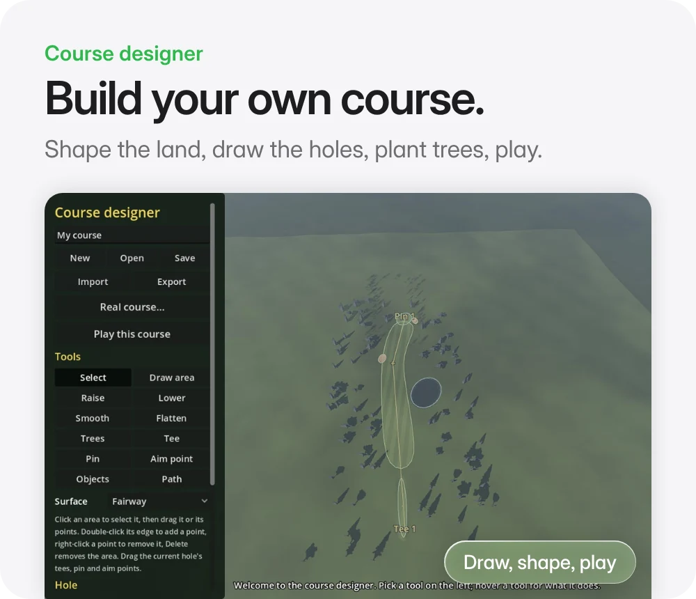

<p align="center">
<picture>
  <source media="(prefers-color-scheme: dark)" srcset="docs/brand/readme/hero-dark.webp">
  
</picture>
</p>

<p align="center">
<a href="https://crspytopgn.github.io/openlinks2003/"><picture><source media="(prefers-color-scheme: dark)" srcset="docs/brand/readme/button-play-dark.png"></picture></a>
&nbsp;
<a href="https://github.com/crspytopgn/openlinks2003/releases/tag/latest"><picture><source media="(prefers-color-scheme: dark)" srcset="docs/brand/readme/button-download-dark.png"></picture></a>
</p>

<p align="center">
<picture>
  <source media="(prefers-color-scheme: dark)" srcset="docs/brand/readme/screen-dark.webp">
  
</picture>
</p>

<p align="center">
An open-source, cross-platform reimplementation of <b>Links 2003</b>,<br>
built with Godot 4 and a portable C++ core.
</p>

> [!IMPORTANT]
> **You need your own copy of the original game for its courses, golfers and
> sounds.** This project contains no code, art, audio, course or other data
> from Links 2003. The engine reads assets at runtime from your copy; out of
> the box it plays a built-in placeholder course. See
> [docs/clean-room.md](docs/clean-room.md).

<p align="center">
<picture><source media="(prefers-color-scheme: dark)" srcset="docs/brand/readme/tile-broadcast-dark.webp"></picture>
<picture><source media="(prefers-color-scheme: dark)" srcset="docs/brand/readme/tile-tracer-dark.webp"></picture>
</p>
<p align="center">
<picture><source media="(prefers-color-scheme: dark)" srcset="docs/brand/readme/tile-swing-dark.webp"></picture>
<picture><source media="(prefers-color-scheme: dark)" srcset="docs/brand/readme/tile-designer-dark.webp"></picture>
</p>

## Play in the browser

The latest `main` build is published to
**https://crspytopgn.github.io/openlinks2003/** (desktop Chrome, Firefox,
Edge or Safari; needs WebGL 2).

It plays with placeholder content out of the box. To use the real courses,
textures, objects and sounds, choose **Load disc images** on the first screen
and pick your own Links 2003 disc images (`.b6i`, `.iso` and other formats,
from any drive), or **Load a game folder** for an installed copy. The files
are read where they are, on your own computer: nothing is copied or uploaded,
and the site itself hosts no game data. Chrome and Edge remember your choice
and only ask to allow access again next time; other browsers ask you to pick
the files again. **Forget my files** clears the remembered choice.

## Download a build

Every push to `main` builds the game for all three platforms and publishes
it as the **[latest release](https://github.com/crspytopgn/openlinks2003/releases/tag/latest)**
(macOS universal, Windows, Linux). The builds contain no game data.

**macOS:** the build is ad-hoc signed, not notarised. Unzip it, move
OpenLinks2003.app to Applications, then right-click it, choose **Open**, and
confirm. On macOS 15 or later, if it still won't open, go to **System
Settings > Privacy & Security** and click **Open Anyway**.

## Using your game files

Point the game at your Links 2003 files (the install folder, the `GAME`
folder from CD 1, or a folder you extracted with `tools/cdimage`) with
`--links-dir=/path/to/folder` on the command line, the `LINKS2003_DIR`
environment variable, or `folder=` under `[game]` in `user://settings.cfg`.
The round then plays the original swing, landing, cup and splash sounds,
and your golfer (the first archive in `POLYANI`, or set `golfer=ERIC.L3`
under `[game]`) appears as the original textured model, holding the
driver, iron or putter, and plays the original swing, chip, half swing and
putt animations for each shot. Also under `[game]`: `golfer_detail=low` for
the low-detail model, and `shirts=2` or `pants=3` to pick the golfer's
outfit. The browser build can't read local folders yet.

## What's inside

- **`libs/olcore`**: a dependency-free C++17 core. Readers for the original
  formats (`LSls` archives with their LZW compression, `.SSF` sound banks,
  WAV, the golfer object store, courses), and the ball physics: flight,
  bounce and roll per surface, holing out, clubs, the swing-to-launch
  mapping and scoring. All with tests.
- **`game/`**: the Godot 4.4 game. The classic three-click swing meter and
  the mouse swing, broadcast presentation, photoreal looks that scale from
  phones to high-end PCs, a course designer, career mode, computer
  opponents and handicaps. Decoders plug in through the interfaces in
  [docs/game-shell.md](docs/game-shell.md).
- **`tools/`**: command-line inspectors and extractors for the original
  files, read straight from your disc images.

```
libs/olcore/    Portable C++ core: file formats, physics (engine-independent)
tools/oldump/   File inspection tool for format reverse engineering
tools/cdimage/  Reads files from raw CD images (.b6i, .iso)
tools/mac/      Installs and wraps the original game for macOS under Wine
tools/lsarchive/ Lists and extracts LSls archives and .SSF sound banks
game/           Godot 4 project (scenes, scripts, export presets)
docs/           Clean-room rules and file-format notes
```

## Building locally

The core library and tools:

```bash
cmake -S . -B build -DCMAKE_BUILD_TYPE=Release
cmake --build build --parallel
ctest --test-dir build --output-on-failure
```

The game: open `game/project.godot` in Godot 4.4 and press F5.

## Roadmap

See [ROADMAP.md](ROADMAP.md).

## Brand

The logo, app icon and the images on this page live in
[docs/brand](docs/brand/README.md), with the scripts that make them.

## Supporting the project

OpenLinks2003 is free and always will be. If you enjoy it and want to chip in,
you can [sponsor it on GitHub](https://github.com/sponsors/crspytopgn).

## Licence

MIT. See [LICENSE](LICENSE). Links 2003 is a trademark of its respective
owners; this project is not affiliated with or endorsed by them.
