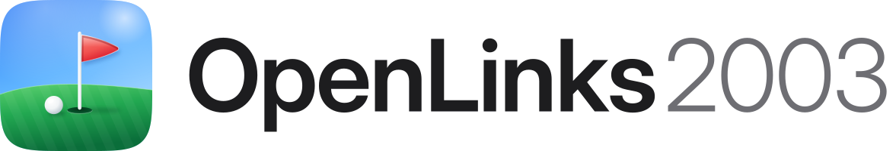

# OpenLinks2003 brand

<p>

&nbsp;&nbsp;
<picture><source media="(prefers-color-scheme: dark)" srcset="wordmark-dark.svg"></picture>
</p>

An app icon in the iOS style: a continuous-corner squircle, sky over a
mown green, a white pin in the cup, a ball, and a red Liquid Glass pennant
that frosts and tints whatever is behind it. Everything here is our own
artwork. None of it comes from Links 2003 or its discs.

## Files

| File | Use |
| --- | --- |
| `app-icon.svg` | Master icon, 1024 x 1024 |
| `png/app-icon-{16..1024}.png` | Icon at 16, 32, 64, 128, 180 (Apple touch), 256, 512, 1024 |
| `wordmark-light.svg`, `wordmark-dark.svg` | Icon and name, for light and dark backgrounds (text outlined) |
| `png/wordmark-*.png` | The same as PNG |
| `social-preview.jpg` | GitHub social preview, 1280 x 640 |
| `readme/` | README hero, screenshot, feature tiles and buttons, light and dark |

`game/icon.png` is the 256 px icon, used by Godot for the window, the
desktop builds and the web page's favicon.

## Guidelines

- Leave clear space around the icon of at least a quarter of its width.
- Don't recolour, stretch, outline or add effects to the icon or wordmark.
- The wordmark is **OpenLinks** in Inter Display SemiBold with **2003** in
  Inter Display Light, in Apple's greys (`#1D1D1F` / `#6E6E73` on light,
  `#F5F5F7` / `#A1A1A6` on dark).
- Accent colours: green `#30B94D`, blue `#0071E3`, flag red `#FF3B30`.

## Social preview

GitHub doesn't take the social preview from the repository: upload
`social-preview.jpg` under **Settings > General > Social preview**.

## Rebuilding

```bash
pip install fonttools
python3 tools/brand/make_brand.py   # SVG icon and wordmarks
node tools/brand/render.js          # PNGs, README images, social card
```

`render.js` uses the Playwright Chromium in the cloud sessions (or any
`npm i playwright` install). The HTML templates are in
`tools/brand/templates/`, the screenshots in `tools/brand/shots/`: CI
render-check frames of the built-in Placeholder Nine, so they show no
original game data. Replace them with newer CI renders as the game improves.

Fonts: Inter Display, SIL Open Font License 1.1 (https://rsms.me/inter/).
